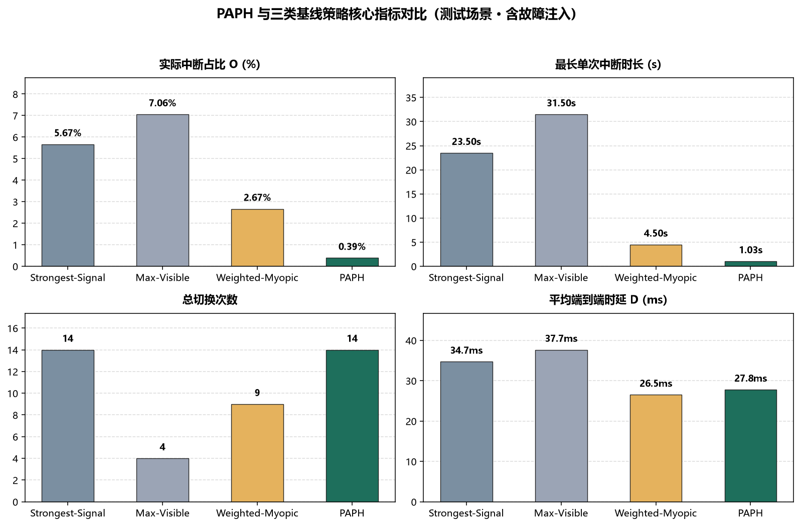
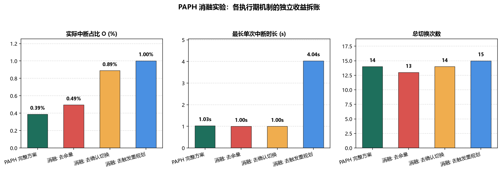
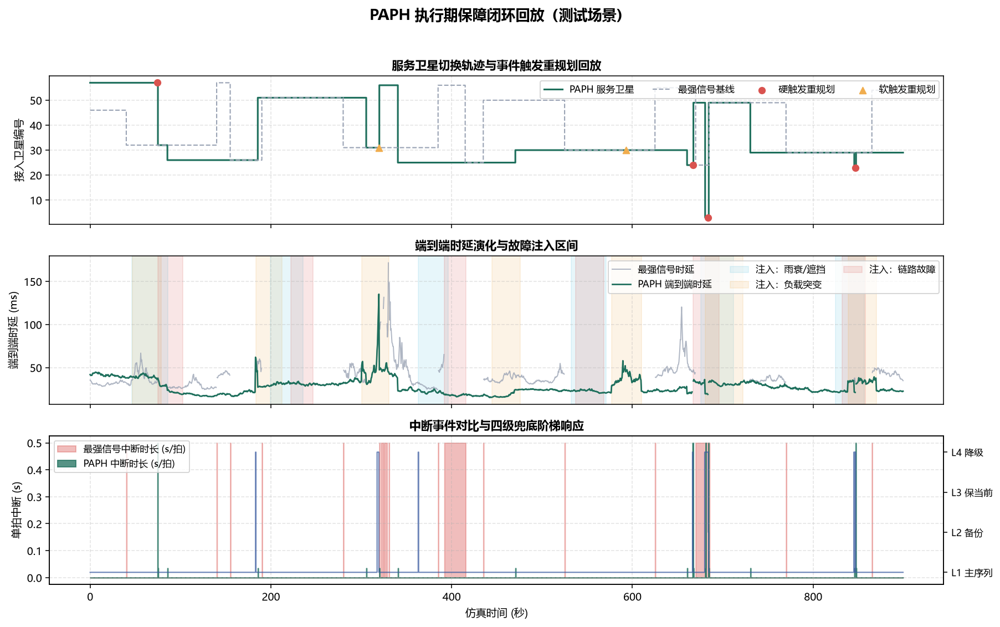
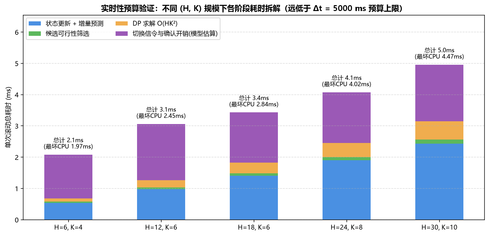

# PAPH · 面向低轨星地网络的预测切换执行期连续性保障仿真平台

> **选星之后，如何保证一段时间内通信不出问题？**  
> 本项目是大学计算机网络实验项目 **PAPH（Predictive Handover for LEO Satellite-Terrestrial Networks）** 的完整 Python 离散时间仿真实现，涵盖**数据—计算—执行三层架构**、**四大执行期保障机制**、**四级兜底阶梯**以及**基线对照 / 消融 / 故障注入 / 实时性预算**验证体系。

---

## 一、核心思想与系统架构

将未来保障窗口 $H \cdot \Delta t$ 内的不确定性拆解为三类分量，各自匹配对应工程工具：

1. **确定性分量（轨道几何）**：采用 Walker-Delta 低轨星座（或 CelesTrak 真实 TLE + SGP4）离线预计算仰角、斜距、多普勒、剩余可见时长与信关站出口可达性，在线查表摊销。
2. **统计性分量（路径负载与拥塞）**：基于 AR(1) 时间相关外生负载模型，输出期望与随步长增长的不确定度区间 $(\hat{L}, \sigma_L)$、$(\hat{O}, \sigma_O)$，并持续进行 EWMA 滚动残差校准。
3. **随机性分量（雨衰 / 遮挡 / 突发硬故障 / 负载尖峰）**：不强行预测单次随机事件，而是通过**安全余量 + 确认式切换 + 触发式增量重规划 + 四级兜底阶梯**实现风险免疫与快速恢复。

### 三层代码结构

```text
paph-leo-handover-sim/
├── config/
│   └── scenarios.yaml          # 验证场景(调参)与测试场景(评估)分离配置、AHP 矩阵与参数
├── env/                        # 【数据层 & 物理仿真环境】
│   ├── orbit.py                # Walker-Delta 低轨星座 / CelesTrak SGP4 离线预计算
│   ├── channel_load.py         # AR(1) 动态负载、斜路径雨衰 1/sin(θ)、端到端时延与故障注入器
│   └── traffic.py              # 双优先级业务流（信令/关键数据 vs 普通业务排队兜底）
├── core/                       # 【计算层】
│   ├── predictor.py            # 机制一：统计外推 + 在线 EWMA 滚动偏差校准
│   ├── planner.py              # 机制二：AHP 赋权 + 带余量与机会约束的逆向 DP（同步产出主/备序列）
│   └── monitor.py              # 机制四：在线偏差/异常监控 + 周期/软/硬触发增量重规划
├── exec_layer/                 # 【执行层】
│   ├── handover_fsm.py         # 机制三：Make-before-break 确认式切换状态机（先确认、后释放、失败回退）
│   └── fallback.py             # 四级兜底阶梯（L1 主序列 → L2 备份候选 → L3 保持当前星 → L4 业务降级）
├── baselines/
│   └── policies.py             # 最强信号 / 最长可见 / 接入加权 / PAPH（含消融开关）
├── scripts/
│   └── fetch_tle.py            # 可选：一键下载 CelesTrak 公开 Starlink TLE 星历
├── tests/
│   └── test_core.py            # 核心算法与状态机单元测试
├── sim_engine.py               # 双时间尺度（微步长 δt = 0.5 s，规划周期 Δt = 5 s）主仿真引擎
├── run_experiments.py          # 一键运行全部对比/消融/实时性/敏感性实验并生成图表
└── results/                    # 导出的 CSV 数据表与 5 张高清分析图表
```

---

## 二、快速开始

### 1. 环境准备（Python 3.10+）

```bash
pip install -r requirements.txt
```

### 2. 运行单元测试

```bash
python -m unittest discover -s tests -v
```

### 3. 一键复现全部仿真实验与图表

```bash
python run_experiments.py
```

运行完成后，结果表格输出在 `results/*.csv`，高清图表输出在 `results/figures/*.png`。

### 4. （可选）切换为 CelesTrak 真实 Starlink TLE 星历回放

默认配置采用内置高密 Walker-Delta 低轨星座（864 颗星，550 km 高度，53° 倾角），无需联网即可 100% 复现。如需回放真实 Starlink 轨道：

```bash
pip install sgp4
python scripts/fetch_tle.py
```

然后在 `config/scenarios.yaml` 中将 `constellation.mode` 修改为 `"tle"` 后重新运行 `python run_experiments.py`。

---

## 三、测试场景仿真结果摘要

实验严格遵循**验证场景与测试场景分离**原则：验证场景（`seed=101`，轨道偏移 0 s）用于核验参数标定，测试场景（`seed=2026`，轨道偏移 1850 s，独立注入 19 个雨衰/负载尖峰/硬故障事件及系统性预测漂移）用于最终评估。AHP 权重为 $(\alpha, \beta, \gamma, \delta) = (0.249, 0.136, 0.171, 0.444)$，一致性比率 $\text{CR} = 0.0023 < 0.10$。

### 1. 基线策略对比（测试场景 · 900 s）

| 策略 | 实际中断占比 $O$ (%) | 最长单次中断 (s) | 总切换次数 | 平均端到端时延 $D$ (ms) | 关键信令丢包率 (%) |
| :--- | :---: | :---: | :---: | :---: | :---: |
| Strongest-Signal（最强信号） | 5.67 | 23.50 | 14 | 34.72 | 5.67 |
| Max-Visible（最长可见） | 7.06 | 31.50 | 4 | 37.66 | 7.06 |
| Weighted-Myopic（接入加权） | 2.67 | 4.50 | 9 | 26.53 | 2.67 |
| **PAPH（本方案）** | **0.39** | **1.03** | **14** | **27.79** | **0.22** |



### 2. 消融实验拆账（验证各执行期机制的独立贡献）

| 变体 | 实际中断占比 $O$ (%) | 最长单次中断 (s) | 平均时延 (ms) | 事件触发次数 | 确认回退次数 |
| :--- | :---: | :---: | :---: | :---: | :---: |
| **PAPH 完整方案** | **0.39** | **1.03** | **27.79** | 6 | 0 |
| 消融 A：去余量 (`use_margin=False`) | 0.49 | 1.00 | 26.17 | 11 | 3 |
| 消融 B：去确认式切换 (`use_mbb=False`) | 0.89 | 1.00 | 27.70 | 6 | 0 |
| 消融 C：去触发重规划 (`use_event_trigger=False`) | 1.00 | 4.04 | 27.62 | 0 | 0 |

- **去余量**：平均时延降低约 1.6 ms，但中断占比上升、触发重规划从 6 次增至 11 次且出现 3 次确认失败回退，直观体现“以可控的微小时间/时延让步换取风险免疫”。
- **去确认式切换**：退化为传统先断后连（Break-before-make），中断占比翻倍以上（0.39% → 0.89%）。
- **去触发重规划**：遇到突发故障只能干等下一个 $\Delta t = 5\text{ s}$ 周期，最长单次中断从 1.03 s 恶化至 4.04 s。



### 3. 执行期闭环回放与实时性预算验证

- **闭环回放**：在故障注入区间内，PAPH 通过硬/软触发增量重规划与 L1–L4 兜底阶梯迅速规避长达 23.5 s 的连续中断。
- **实时性预算**：在 $(H=30, K=10)$ 上限下，单次滚动平均纯计算耗时仅 **3.15 ms**（最坏 **4.47 ms**），叠加信令开销仍远低于 $\Delta t = 5000\text{ ms}$ 预算（占比 $< 0.15\%$）。





---

## 四、诚实边界与后续扩展方向

与方案设计一致，本仿真明确以下边界：
1. **兜底 $\neq$ 零中断**：当所有可见星同时遭受极端遮挡或服务星突发硬件失步时，仍会产生约 0.5–1.0 s 的检测与接管恢复窗口；
2. **时延与安全性的权衡**：仰角与风险余量主动放弃了部分低仰角“账面最低时延”路径，以换取更低的实际中断风险；
3. **冷启动限制**：新入视野卫星在观测样本较少时，统计预测依赖全局偏差先验与膨胀不确定度 $\sigma$，随观测积累逐步收敛；
4. **单用户外生负载假设**：首版聚焦单终端接入与外生负载演化，后续可扩展为多用户博弈负载耦合及 UDP/Mininet 真实数据包回放。
